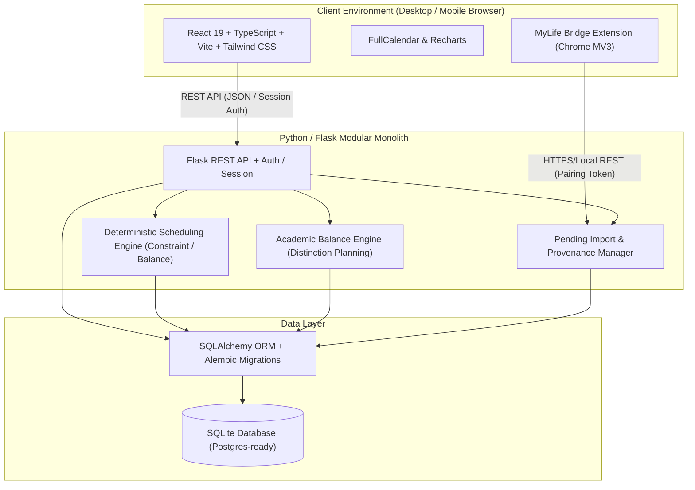

# MyLife OS — System Architecture Document

## 1. System Vision & Overview
**MyLife OS** is a modular personal productivity and life-management platform built specifically for a university student balancing:
1. **Academic Performance**: JKUAT SODeL BSc IT studies with a strict **Distinction-focused** target (requiring balanced unit coverage, spaced revision, CAT & exam preparation).
2. **Technical Skills Development**: 4 primary tracks (Python, Cybersecurity, Web Development, Networking) with adjustable targets (starting at ~3h/day = 21h/week).
3. **Career & Job Pursuit**: Opportunities pipeline, CV versions, interview prep, skills gap analysis.
4. **Projects & Practical Evidence**: Real portfolio projects linked to academic units and skills.
5. **Life Balance & Scheduling**: A deterministic, constraint-based Python scheduling engine with overload detection, "Reschedule My Day", and balanced unit attention safeguards.
6. **Assisted LMS Integration (MyLife Bridge)**: A read-only Chrome Manifest V3 extension extracting course, assignment, assessment, and announcement data from JKUAT SODeL (`https://sodel3v2.jkuat.ac.ke`) with human-in-the-loop review.

---

## 2. Architectural Paradigm: Modular Monolith
To ensure high maintainability, rapid local development, and zero unnecessary cloud dependencies, MyLife OS is designed as a **Modular Monolith**:

---

## 3. Component Architecture

### 3.1 Frontend (`frontend/`)
- **Core Framework**: React 19, TypeScript, Vite.
- **Styling**: Tailwind CSS with custom dark mode default, subtle borders, high-contrast readable typography.
- **Routing**: React Router v7.
- **Calendar & Timetable**: FullCalendar (Day, Week, Month, List views) with drag-and-drop event manipulation and category color coding.
- **Visualizations**: Recharts for weekly balance distribution, skill track completion, and academic coverage.
- **Iconography**: Lucide React.
- **Design System**: Atomic UI components (`Card`, `Badge`, `Button`, `Modal`, `Input`, `EmptyState`, `AlertBanner`, `ProgressBar`).

### 3.2 Backend (`backend/`)
- **Framework**: Python 3.13 + Flask.
- **API Design**: Blueprints organized cleanly by domain:
  - `/api/auth`: User registration, session login, logout, current user context.
  - `/api/dashboard`: Aggregated multi-domain metrics and personalized layout preferences.
  - `/api/academics`: Terms, units, assignments, subtasks, assessments, topics, resources.
  - `/api/distinction`: Academic Balance Engine, study hour allocations, attention gap tracker, topic mastery ratings.
  - `/api/scheduler`: Timetable generation, availability rules, "Reschedule My Day", schedule versions, overload metrics.
  - `/api/skills`: Roadmap stages, learning topics, sessions, practical evidence attachments.
  - `/api/career`: Job opportunities, pipeline Kanban, CV documents, interview prep, skills gap.
  - `/api/projects`: Project milestones, tasks, link to skills and courses.
  - `/api/analytics`: Weekly reviews, Life Balance Monitor, goal vs. actual charts.
  - `/api/integrations/sodel`: Chrome extension pairing, scan intake, pending imports review, approval/rejection.
  - `/api/settings`: Timezones (`Africa/Nairobi`), weights, study limits, backup/restore.
- **Database & Migration**: SQLAlchemy 2.0 with Alembic / Flask-Migrate.

### 3.3 MyLife Bridge Extension (`mylife-bridge/`)
- **Standard**: Chrome Manifest V3.
- **Security & Privacy Safeguards**:
  - Never prompts for or stores JKUAT password or session cookies.
  - Read-only DOM scraping executed only on user-initiated click.
  - Host permission restricted strictly to `https://sodel3v2.jkuat.ac.ke/*`.
  - Communicates with local MyLife OS via cryptographically random pairing token.
  - Sends extracted records to a sandbox `Pending Imports` queue.
  - Requires explicit user approval before touching official academic tables.

---

## 4. Key Subsystems

### 4.1 Academic Balance Engine & Distinction Planner
- Calculates **Attention Gap**:
  $$\text{Attention Gap} = \text{Target Weekly Hours} - \text{Actual Study Hours}$$
- Monitors rolling 14-day study distribution across all registered units.
- Ensures no unit falls below minimum thresholds ($H_{\min}$).
- Integrates topic-level mastery scoring ($1 \dots 5$) and spaced revision schedules (Day 1, Day 4, Day 7, Pre-assessment).
- Proactively highlights neglected units on the Academic Dashboard.

### 4.2 Deterministic Scheduling Engine
- Unified task abstraction: `SchedulableTask` unifying academic assignments/revision, skill learning tasks, career prep, and project milestones.
- Availability matrix: Per-day flexible availability intervals, fixed commitments, locked blocks, and protected rest periods.
- Priority scoring formula:
  $$P = 0.35 D + 0.25 U + 0.20 I + 0.10 W + 0.10 R$$
  with dynamic boosts for Attention Gap ($+0.15$) and CAT/Exam proximity ($+0.30$).
- Overload detection: Computes total required hours versus net available hours. If $\text{Required} > \text{Available}$, emits an actionable overload report with reduction/deferral suggestions rather than creating an impossible schedule.
- "Reschedule My Day": Re-evaluates missed or in-progress tasks for the current day without disturbing locked future blocks or deleting unfinished work.

