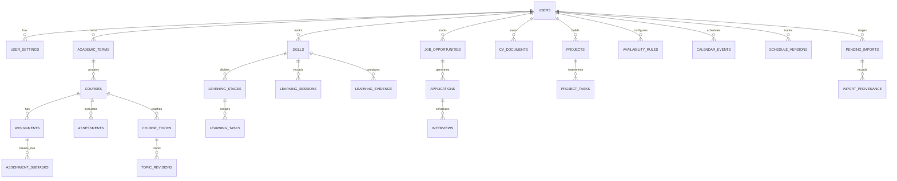

# MyLife OS — Database Design & Schema Specification

## 1. Design Principles
1. **Relational Normalization**: 3NF normalized tables with clear foreign keys, cascading rules, and check constraints.
2. **PostgreSQL Compatibility**: All schemas use standard ANSI SQL datatypes (`INTEGER`, `VARCHAR`, `TEXT`, `BOOLEAN`, `TIMESTAMP`, `NUMERIC`). SQLite uses standard affinity mapping without SQLite-specific proprietary quirks.
3. **Auditability & Provenance**: Core entities include `created_at` and `updated_at`. Imported records maintain explicit foreign key links to `import_provenance` records.
4. **Separation of Staging and Production**: External LMS scraped items reside strictly in `pending_imports` until approved and transitioned to `courses`, `assignments`, or `assessments`.
5. **Unified Schedulable Task Abstraction**: Distinct domain items map to a unified scheduling interface or contain scheduling metadata columns.

---

## 2. Entity-Relationship Overview

---

## 3. Detailed Table Definitions

### 3.1 User & Preferences
- `users`:
  - `id`: INTEGER PRIMARY KEY AUTOINCREMENT
  - `email`: VARCHAR(255) UNIQUE NOT NULL
  - `password_hash`: VARCHAR(255) NOT NULL
  - `display_name`: VARCHAR(120) NOT NULL
  - `timezone`: VARCHAR(64) DEFAULT 'Africa/Nairobi'
  - `created_at`: TIMESTAMP DEFAULT CURRENT_TIMESTAMP
  - `updated_at`: TIMESTAMP DEFAULT CURRENT_TIMESTAMP

- `user_settings`:
  - `id`: INTEGER PRIMARY KEY AUTOINCREMENT
  - `user_id`: INTEGER NOT NULL REFERENCES users(id) ON DELETE CASCADE
  - `time_format`: VARCHAR(10) DEFAULT '24h'
  - `first_day_of_week`: INTEGER DEFAULT 1 (Monday)
  - `default_session_duration_mins`: INTEGER DEFAULT 60
  - `max_daily_study_hours`: NUMERIC(4,1) DEFAULT 8.0
  - `skills_daily_target_hours`: NUMERIC(4,1) DEFAULT 3.0
  - `career_weekly_apps_target`: INTEGER DEFAULT 3
  - `priority_weights_json`: TEXT (JSON configuration for scheduler weights)
  - `theme_appearance`: VARCHAR(20) DEFAULT 'dark'
  - `accent_color`: VARCHAR(20) DEFAULT 'indigo'
  - `dashboard_layout_json`: TEXT (Widget ordering and visibility)

### 3.2 Academics & Distinction Tracking
- `academic_terms`:
  - `id`: INTEGER PRIMARY KEY AUTOINCREMENT
  - `user_id`: INTEGER NOT NULL REFERENCES users(id) ON DELETE CASCADE
  - `name`: VARCHAR(100) NOT NULL (e.g. "Year 2 Semester 2")
  - `start_date`: DATE NOT NULL
  - `end_date`: DATE NOT NULL
  - `is_current`: BOOLEAN DEFAULT 1

- `courses`:
  - `id`: INTEGER PRIMARY KEY AUTOINCREMENT
  - `term_id`: INTEGER NOT NULL REFERENCES academic_terms(id) ON DELETE CASCADE
  - `code`: VARCHAR(30) NOT NULL (e.g. "ICS 2303")
  - `title`: VARCHAR(200) NOT NULL (e.g. "Web Development 1")
  - `lecturer_name`: VARCHAR(120)
  - `lecturer_email`: VARCHAR(120)
  - `difficulty_level`: INTEGER DEFAULT 3 (Scale 1-5)
  - `academic_importance`: INTEGER DEFAULT 4 (Scale 1-5)
  - `min_weekly_hours`: NUMERIC(4,1) DEFAULT 4.0
  - `target_weekly_hours`: NUMERIC(4,1) DEFAULT 6.0
  - `target_grade`: VARCHAR(10) DEFAULT 'Distinction'
  - `is_archived`: BOOLEAN DEFAULT 0
  - `created_at`: TIMESTAMP DEFAULT CURRENT_TIMESTAMP

- `course_topics`:
  - `id`: INTEGER PRIMARY KEY AUTOINCREMENT
  - `course_id`: INTEGER NOT NULL REFERENCES courses(id) ON DELETE CASCADE
  - `title`: VARCHAR(200) NOT NULL
  - `order_index`: INTEGER DEFAULT 0
  - `status`: VARCHAR(30) DEFAULT 'Not Started' (Not Started, Learning, Practicing, Needs Revision, Understood, Mastered)
  - `confidence_score`: INTEGER DEFAULT 1 (1-5)
  - `last_revised_at`: TIMESTAMP
  - `notes`: TEXT

- `topic_revisions`:
  - `id`: INTEGER PRIMARY KEY AUTOINCREMENT
  - `topic_id`: INTEGER NOT NULL REFERENCES course_topics(id) ON DELETE CASCADE
  - `revision_date`: DATE NOT NULL
  - `duration_mins`: INTEGER DEFAULT 45
  - `confidence_after`: INTEGER (1-5)
  - `notes`: TEXT

- `assignments`:
  - `id`: INTEGER PRIMARY KEY AUTOINCREMENT
  - `course_id`: INTEGER NOT NULL REFERENCES courses(id) ON DELETE CASCADE
  - `title`: VARCHAR(255) NOT NULL
  - `description`: TEXT
  - `assignment_type`: VARCHAR(50) DEFAULT 'Assignment' (Assignment, Project, Lab)
  - `assigned_date`: DATE
  - `deadline`: TIMESTAMP
  - `has_explicit_time`: BOOLEAN DEFAULT 0
  - `estimated_effort_hours`: NUMERIC(4,1) DEFAULT 3.0
  - `actual_effort_hours`: NUMERIC(4,1) DEFAULT 0.0
  - `priority`: INTEGER DEFAULT 3 (1-5)
  - `status`: VARCHAR(30) DEFAULT 'Not Started' (Not Started, In Progress, Submitted, Completed, Overdue)
  - `max_marks`: NUMERIC(5,2)
  - `score_received`: NUMERIC(5,2)
  - `source_system`: VARCHAR(50) DEFAULT 'MANUAL' (MANUAL, SODEL)
  - `source_url`: TEXT
  - `created_at`: TIMESTAMP DEFAULT CURRENT_TIMESTAMP
  - `updated_at`: TIMESTAMP DEFAULT CURRENT_TIMESTAMP

- `assignment_subtasks`:
  - `id`: INTEGER PRIMARY KEY AUTOINCREMENT
  - `assignment_id`: INTEGER NOT NULL REFERENCES assignments(id) ON DELETE CASCADE
  - `title`: VARCHAR(255) NOT NULL
  - `estimated_mins`: INTEGER DEFAULT 60
  - `order_index`: INTEGER DEFAULT 0
  - `is_completed`: BOOLEAN DEFAULT 0
  - `completed_at`: TIMESTAMP

- `assessments`:
  - `id`: INTEGER PRIMARY KEY AUTOINCREMENT
  - `course_id`: INTEGER NOT NULL REFERENCES courses(id) ON DELETE CASCADE
  - `title`: VARCHAR(200) NOT NULL (e.g. "CAT 1", "Final Examination")
  - `assessment_type`: VARCHAR(30) NOT NULL (CAT, Exam, Quiz)
  - `assessment_date`: TIMESTAMP NOT NULL
  - `has_explicit_time`: BOOLEAN DEFAULT 0
  - `weight_percentage`: NUMERIC(5,2)
  - `max_marks`: NUMERIC(5,2)
  - `score_received`: NUMERIC(5,2)
  - `preparation_progress`: INTEGER DEFAULT 0 (0-100%)
  - `notes`: TEXT

- `academic_resources`:
  - `id`: INTEGER PRIMARY KEY AUTOINCREMENT
  - `course_id`: INTEGER NOT NULL REFERENCES courses(id) ON DELETE CASCADE
  - `topic_id`: INTEGER REFERENCES course_topics(id) ON DELETE SET NULL
  - `title`: VARCHAR(255) NOT NULL
  - `resource_type`: VARCHAR(50) (PDF, URL, Video, Note)
  - `file_path`: TEXT
  - `external_url`: TEXT
  - `notes`: TEXT

### 3.3 Scheduling & Timetable
- `availability_rules`:
  - `id`: INTEGER PRIMARY KEY AUTOINCREMENT
  - `user_id`: INTEGER NOT NULL REFERENCES users(id) ON DELETE CASCADE
  - `day_of_week`: INTEGER NOT NULL (0=Sunday ... 6=Saturday)
  - `start_time`: VARCHAR(5) NOT NULL (e.g. "08:00")
  - `end_time`: VARCHAR(5) NOT NULL (e.g. "12:00")
  - `is_active`: BOOLEAN DEFAULT 1

- `calendar_events`:
  - `id`: INTEGER PRIMARY KEY AUTOINCREMENT
  - `user_id`: INTEGER NOT NULL REFERENCES users(id) ON DELETE CASCADE
  - `title`: VARCHAR(255) NOT NULL
  - `category`: VARCHAR(50) NOT NULL (academic, skill, career, project, personal, rest)
  - `start_time`: TIMESTAMP NOT NULL
  - `end_time`: TIMESTAMP NOT NULL
  - `is_locked`: BOOLEAN DEFAULT 0
  - `is_completed`: BOOLEAN DEFAULT 0
  - `is_skipped`: BOOLEAN DEFAULT 0
  - `related_entity_type`: VARCHAR(50) (assignment, assessment, course, learning_task, application, project_task)
  - `related_entity_id`: INTEGER
  - `notes`: TEXT
  - `schedule_version_id`: INTEGER REFERENCES schedule_versions(id) ON DELETE SET NULL

- `schedule_versions`:
  - `id`: INTEGER PRIMARY KEY AUTOINCREMENT
  - `user_id`: INTEGER NOT NULL REFERENCES users(id) ON DELETE CASCADE
  - `version_number`: INTEGER NOT NULL
  - `start_date`: DATE NOT NULL
  - `end_date`: DATE NOT NULL
  - `status`: VARCHAR(20) DEFAULT 'ACTIVE' (DRAFT, ACTIVE, ARCHIVED, SUPERSEDED)
  - `generation_metrics_json`: TEXT
  - `created_at`: TIMESTAMP DEFAULT CURRENT_TIMESTAMP

### 3.4 Skills Development
- `skills`:
  - `id`: INTEGER PRIMARY KEY AUTOINCREMENT
  - `user_id`: INTEGER NOT NULL REFERENCES users(id) ON DELETE CASCADE
  - `track_name`: VARCHAR(100) NOT NULL (Python, Cybersecurity, Web Development, Networking)
  - `current_level`: VARCHAR(30) DEFAULT 'Beginner' (Beginner, Intermediate, Advanced)
  - `weekly_target_hours`: NUMERIC(4,1) DEFAULT 5.0
  - `color_hex`: VARCHAR(10) DEFAULT '#6366f1'

- `learning_stages`:
  - `id`: INTEGER PRIMARY KEY AUTOINCREMENT
  - `skill_id`: INTEGER NOT NULL REFERENCES skills(id) ON DELETE CASCADE
  - `title`: VARCHAR(200) NOT NULL
  - `order_index`: INTEGER DEFAULT 0
  - `status`: VARCHAR(30) DEFAULT 'Not Started'

- `learning_tasks`:
  - `id`: INTEGER PRIMARY KEY AUTOINCREMENT
  - `stage_id`: INTEGER NOT NULL REFERENCES learning_stages(id) ON DELETE CASCADE
  - `title`: VARCHAR(255) NOT NULL
  - `description`: TEXT
  - `estimated_hours`: NUMERIC(4,1) DEFAULT 2.0
  - `status`: VARCHAR(30) DEFAULT 'Pending' (Pending, In Progress, Completed)
  - `is_completed`: BOOLEAN DEFAULT 0
  - `completed_at`: TIMESTAMP

- `learning_sessions`:
  - `id`: INTEGER PRIMARY KEY AUTOINCREMENT
  - `skill_id`: INTEGER NOT NULL REFERENCES skills(id) ON DELETE CASCADE
  - `task_id`: INTEGER REFERENCES learning_tasks(id) ON DELETE SET NULL
  - `session_date`: TIMESTAMP NOT NULL
  - `duration_mins`: INTEGER NOT NULL
  - `topic_studied`: VARCHAR(255) NOT NULL
  - `key_learnings`: TEXT
  - `difficulties_faced`: TEXT
  - `next_steps`: TEXT

- `learning_evidence`:
  - `id`: INTEGER PRIMARY KEY AUTOINCREMENT
  - `skill_id`: INTEGER NOT NULL REFERENCES skills(id) ON DELETE CASCADE
  - `title`: VARCHAR(255) NOT NULL
  - `evidence_type`: VARCHAR(50) (GitHub, Project, Screenshot, Demo, Certificate)
  - `url_or_path`: TEXT NOT NULL
  - `description`: TEXT
  - `date_achieved`: DATE

### 3.5 Career & Job Management
- `job_opportunities`:
  - `id`: INTEGER PRIMARY KEY AUTOINCREMENT
  - `user_id`: INTEGER NOT NULL REFERENCES users(id) ON DELETE CASCADE
  - `title`: VARCHAR(255) NOT NULL
  - `company`: VARCHAR(255) NOT NULL
  - `location`: VARCHAR(255)
  - `job_type`: VARCHAR(50) DEFAULT 'Internship' (Internship, Attachment, Entry-level, Junior Dev, IT Support, Networking, Cybersecurity, Other)
  - `description`: TEXT
  - `requirements`: TEXT
  - `application_url`: TEXT
  - `closing_date`: DATE
  - `priority`: INTEGER DEFAULT 3
  - `pipeline_stage`: VARCHAR(30) DEFAULT 'Saved' (Saved, Preparing, Applied, Interview, Offer, Rejected, Withdrawn)
  - `notes`: TEXT
  - `created_at`: TIMESTAMP DEFAULT CURRENT_TIMESTAMP

- `applications`:
  - `id`: INTEGER PRIMARY KEY AUTOINCREMENT
  - `job_id`: INTEGER NOT NULL REFERENCES job_opportunities(id) ON DELETE CASCADE
  - `applied_date`: DATE NOT NULL
  - `cv_document_id`: INTEGER REFERENCES cv_documents(id) ON DELETE SET NULL
  - `cover_letter_text`: TEXT
  - `contact_person`: VARCHAR(120)
  - `contact_email`: VARCHAR(120)
  - `status`: VARCHAR(30) DEFAULT 'Applied'
  - `notes`: TEXT

- `cv_documents`:
  - `id`: INTEGER PRIMARY KEY AUTOINCREMENT
  - `user_id`: INTEGER NOT NULL REFERENCES users(id) ON DELETE CASCADE
  - `title`: VARCHAR(200) NOT NULL (e.g. "Junior Developer CV - v2")
  - `category`: VARCHAR(50) (General IT, IT Support, Networking, Junior Developer, Cybersecurity)
  - `file_path`: TEXT
  - `file_size_bytes`: INTEGER
  - `notes`: TEXT
  - `updated_at`: TIMESTAMP DEFAULT CURRENT_TIMESTAMP

- `interviews`:
  - `id`: INTEGER PRIMARY KEY AUTOINCREMENT
  - `application_id`: INTEGER NOT NULL REFERENCES applications(id) ON DELETE CASCADE
  - `scheduled_at`: TIMESTAMP NOT NULL
  - `interview_type`: VARCHAR(50) (Technical, HR, Assessment, Panel)
  - `preparation_checklist_json`: TEXT
  - `company_research_notes`: TEXT
  - `feedback`: TEXT

### 3.6 Projects Workspace
- `projects`:
  - `id`: INTEGER PRIMARY KEY AUTOINCREMENT
  - `user_id`: INTEGER NOT NULL REFERENCES users(id) ON DELETE CASCADE
  - `title`: VARCHAR(255) NOT NULL
  - `description`: TEXT
  - `tech_stack`: VARCHAR(255)
  - `status`: VARCHAR(30) DEFAULT 'In Progress' (Planning, In Progress, On Hold, Completed)
  - `priority`: INTEGER DEFAULT 3
  - `github_url`: TEXT
  - `live_demo_url`: TEXT
  - `linked_skill_id`: INTEGER REFERENCES skills(id) ON DELETE SET NULL
  - `linked_course_id`: INTEGER REFERENCES courses(id) ON DELETE SET NULL
  - `created_at`: TIMESTAMP DEFAULT CURRENT_TIMESTAMP

- `project_tasks`:
  - `id`: INTEGER PRIMARY KEY AUTOINCREMENT
  - `project_id`: INTEGER NOT NULL REFERENCES projects(id) ON DELETE CASCADE
  - `title`: VARCHAR(255) NOT NULL
  - `estimated_hours`: NUMERIC(4,1) DEFAULT 2.0
  - `is_completed`: BOOLEAN DEFAULT 0
  - `order_index`: INTEGER DEFAULT 0

### 3.7 Integrations & MyLife Bridge Staging
- `integrations`:
  - `id`: INTEGER PRIMARY KEY AUTOINCREMENT
  - `user_id`: INTEGER NOT NULL REFERENCES users(id) ON DELETE CASCADE
  - `provider`: VARCHAR(50) NOT NULL (e.g. "sodel")
  - `pairing_token`: VARCHAR(128) NOT NULL UNIQUE
  - `is_active`: BOOLEAN DEFAULT 1
  - `last_sync_at`: TIMESTAMP
  - `sync_metadata_json`: TEXT

- `pending_imports`:
  - `id`: INTEGER PRIMARY KEY AUTOINCREMENT
  - `user_id`: INTEGER NOT NULL REFERENCES users(id) ON DELETE CASCADE
  - `source_system`: VARCHAR(50) DEFAULT 'sodel'
  - `source_url`: TEXT NOT NULL
  - `item_type`: VARCHAR(50) NOT NULL (course, assignment, assessment, announcement)
  - `raw_data_json`: TEXT NOT NULL
  - `normalized_title`: VARCHAR(255) NOT NULL
  - `normalized_course_code`: VARCHAR(50)
  - `normalized_deadline`: TIMESTAMP
  - `has_explicit_time`: BOOLEAN DEFAULT 0
  - `status`: VARCHAR(30) DEFAULT 'Pending Review' (Pending Review, Approved, Rejected, Needs Attention, Updated)
  - `potential_duplicate_id`: INTEGER
  - `changes_diff_json`: TEXT
  - `created_at`: TIMESTAMP DEFAULT CURRENT_TIMESTAMP
  - `reviewed_at`: TIMESTAMP

- `import_provenance`:
  - `id`: INTEGER PRIMARY KEY AUTOINCREMENT
  - `pending_import_id`: INTEGER NOT NULL REFERENCES pending_imports(id) ON DELETE CASCADE
  - `target_table`: VARCHAR(50) NOT NULL
  - `target_record_id`: INTEGER NOT NULL
  - `action_taken`: VARCHAR(50) NOT NULL (CREATED, UPDATED)
  - `approved_by_user_id`: INTEGER NOT NULL REFERENCES users(id) ON DELETE CASCADE
  - `timestamp`: TIMESTAMP DEFAULT CURRENT_TIMESTAMP

### 3.8 Analytics & Weekly Review
- `weekly_reviews`:
  - `id`: INTEGER PRIMARY KEY AUTOINCREMENT
  - `user_id`: INTEGER NOT NULL REFERENCES users(id) ON DELETE CASCADE
  - `week_start_date`: DATE NOT NULL
  - `total_study_hours`: NUMERIC(5,1) DEFAULT 0
  - `total_skills_hours`: NUMERIC(5,1) DEFAULT 0
  - `total_career_hours`: NUMERIC(5,1) DEFAULT 0
  - `units_studied_count`: INTEGER DEFAULT 0
  - `least_attended_course_id`: INTEGER REFERENCES courses(id) ON DELETE SET NULL
  - `most_attended_course_id`: INTEGER REFERENCES courses(id) ON DELETE SET NULL
  - `what_went_well`: TEXT
  - `challenges_encountered`: TEXT
  - `lessons_learned`: TEXT
  - `goals_for_next_week`: TEXT
  - `created_at`: TIMESTAMP DEFAULT CURRENT_TIMESTAMP

