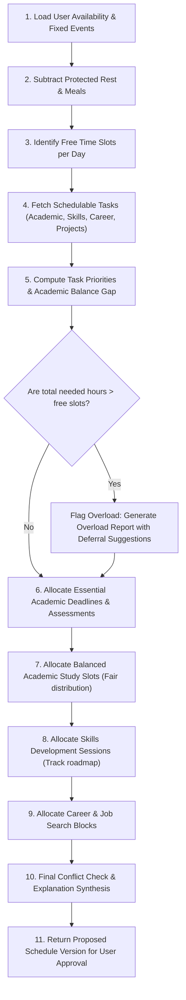

# MyLife OS — Deterministic Scheduling Engine Specification

## 1. Core Principles
1. **Deterministic & Testable**: No black-box AI makes timetable validity decisions. The algorithm is based on linear constraints, interval math, and clear mathematical scoring.
2. **Explainability**: Every scheduled block carries an `explanation` key detailing why it was placed at that time.
3. **Academic Balance & Distinction Safeguards**:
   - Equal attention baseline across all registered units.
   - Attention Gap compensation prevents neglect.
   - Spaced repetition intervals for topic mastery.
   - Proximity boost for CATs and examinations.
4. **Honest Overload Reporting**: If total needed hours exceed available slots, the engine explicitly alerts the user with an Overload Report rather than cramming or creating impossible schedules.
5. **Human In The Loop**: User can approve, modify, lock, or restore previous schedule versions.

---

## 2. Priority Scoring Model

Each schedulable task $T$ receives an base priority score:

$$P = w_D \cdot D + w_U \cdot U + w_I \cdot I + w_W \cdot W + w_R \cdot R + B_{\text{balance}} + B_{\text{exam}}$$

### Default Normalized Weights:
- $w_D = 0.35$ (Deadline Urgency: proximity to cutoff in days)
- $w_U = 0.25$ (Academic/Career Importance: 1-5 normalized)
- $w_I = 0.20$ (Long-term Impact / Goal alignment)
- $w_W = 0.10$ (Workload / Difficulty: 1-5 normalized)
- $w_R = 0.10$ (Risk of falling behind: based on historical missed sessions)

### Distinction Boosts:
- **Academic Attention Gap Boost ($B_{\text{balance}}$)**:
  $$\text{Gap}_c = \text{TargetHours}_c - \text{ActualHours}_c$$
  If $\text{Gap}_c > 0$, task receives up to $+0.20$ boost to pull neglected units back to parity.
- **Assessment Proximity Boost ($B_{\text{exam}}$)**:
  For assessments within 7 days: $+0.30$. Within 14 days: $+0.15$.

---

## 3. Allocation Sequence & Algorithm

---

## 4. Academic Balance Engine Rules

1. **Minimum Floor Guarantee**: Every registered course must be allocated at least its `min_weekly_hours` (e.g. 3-4 hours) before secondary skills/career goals expand.
2. **Rolling 14-Day Smoothing**: Temporary spikes during exam week do not permanently bias the unit's baseline.
3. **Spaced Revision Schedule**:
   - Day 1: Post-lecture concept review (45 mins)
   - Day 4: Practice problems / active recall (60 mins)
   - Day 7: Unit summary & synthesis (45 mins)
   - Pre-CAT/Exam: Intensive mock problems & weak topic review

---

## 5. "Reschedule My Day" Logic

Triggered when:
- User missed morning study blocks.
- An unplanned event or emergency occurs.

Execution steps:
1. Identify remaining time slots from `now()` until end of day availability.
2. Filter for tasks assigned to today that are not completed.
3. Keep locked calendar events untouched.
4. Recalculate remaining slot capacity:
   - If capacity $\ge$ remaining tasks: re-pack tasks into afternoon/evening slots.
   - If capacity $<$ remaining tasks: prioritize tasks with imminent deadlines; defer flexible skill sessions to later in the week; alert user with clear explanation.
5. Present side-by-side diff (Old vs Proposed) for single-click confirmation.

